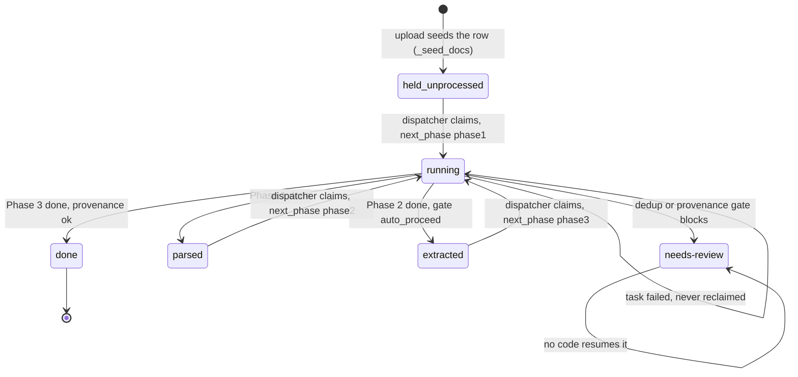

# Document lifecycle: upload to done

Status: implemented. Line numbers are for code at main `0dac86fa`.

This follows one uploaded source document from the S3 upload to the end of Phase 3: which code moves it forward, what state it is in, where it can be taken off the path (`needs-review/`, `quarantine/`), how an operator sees and resolves that, and which alerts fire. It does not repeat these docs:

- Per-extension routing, the AV gate and each track's success and failure path: [INGESTION_PATHS.md](../dataquality/INGESTION_PATHS.md)
- The Phase 2 to Phase 3 dedup and provenance gate: [DEDUP_REVIEW_GATE.md](DEDUP_REVIEW_GATE.md)
- Every DynamoDB key and S3 marker named below (locks, `pending#*`, `title#`, `source#`): [LOCKS_AND_LEASES.md](LOCKS_AND_LEASES.md)
- NAT and networking: [NETWORKING_LIFECYCLE.md](../NETWORKING_LIFECYCLE.md)
- The concurrency design the `doc#` records come from: [CONCURRENCY_AND_NAT_SPEC.md](../dataquality/CONCURRENCY_AND_NAT_SPEC.md) section 8
- Operator commands: [RUNBOOK.md](../RUNBOOK.md)

## 1. Two drivers, one default

`MULTI_DOC_ENABLED` selects who moves a document from phase to phase. It is a CloudFormation parameter that defaults to `false` (`cloudformation/compute.yaml:8-12`, `cloudformation/main.yaml:40-44`). The trigger Lambda reads it at import (`trigger_handler.py:96`) and also needs `DISPATCHER_STATE_MACHINE_ARN` (`trigger_handler.py:105-107`). The phase tasks read the same variable (`ecs_entrypoint.py:4025-4045`, `_multi_doc_enabled`).

| | Serial (default) | Multi-doc |
|---|---|---|
| State lives in | `pending#content`, `pending#parsed#<book>`, `pending#enrich#<book>` rows and the phase lock rows | one `doc#<doc_id>` row per book, plus the `pending#*` rows the trigger still writes |
| Who starts the next phase | The finishing phase task invokes the trigger Lambda (`ecs_entrypoint.py:2343-2361, 2398-2442, 2461-2478`); the 15-minute reconcile is the backstop (`trigger_handler.py:1566-1605`) | The Step Functions dispatcher (`cloudformation/dispatcher.yaml:205-330`) enumerates READY `doc#` rows, runs one ECS task per doc and loops until none are READY |
| Phase end writes | nothing per document | `_advance_doc_lifecycle` or `_offramp_doc_needs_review` (`ecs_entrypoint.py:2030-2084`) |

## 2. The path in serial mode

1. **Upload.** An object under `contentrepository/` fires `s3:ObjectCreated:*` with no suffix filter into the `<env>-wwii-content-uploaded` topic (`cloudformation/events.yaml:802-815`). A `-parsed.json` object under `output/content/` fires the `<env>-wwii-chapter-parsed` topic (816-822).
2. **Trigger entry.** `handler` (`trigger_handler.py:1412-1445`) dispatches on `event["source"]`: `manual` (1384), `scheduled` (1664), an ECS task-stopped event (1369), `phase-complete` (1528). Anything else is read as SNS or SQS records by `_extract_records` (1690-1733), which keeps keys only from a trusted topic and logs `OBSERV trigger.untrusted_keys_dropped` for the rest. The keys are merged into `manifests/pending.json` (`_update_manifest`, 1760), then `_route_topics` (1448-1475) picks the handler by topic.
3. **Content topic.** `_handle_content_topic` (1478-1509):
   - `_content_keys` (840-882) keeps processable keys. Archives, `_figures/` outputs and `-meta.yaml` sidecars are skipped. An unlisted extension goes to `needs-review/unrecognized-type/`.
   - `_split_by_media` (885-903) returns the OCR, convert, video and parse key lists.
   - `_av_gate` (1865-1883) scans the three binary lists. It fails closed: on an error it drops all of them from this batch.
   - OCR keys: `_submit_ocr_batch` (1512) then `_submit_ocr` (1195) after `_ocr_intake_refused` (1182). Convert keys: `_submit_convert` (2003). Video keys: `_submit_video` (1988). Each of the last two runs `_unnamed_upload` and `_source_renamed` first.
   - Parse keys (`.md`, `.txt`): `_validate_parse_keys` (730), `_queue_pending` (2329), then `_launch_phase1_if_idle` (2343), or in multi-doc mode `_seed_docs` plus `_start_dispatcher` (1505-1508).
4. **Phase 0 products re-enter at step 1.** OCR output is merged by `ocr_merge_handler.merge_ocr_output` (`ocr_merge_handler.py:319`) and promoted to `contentrepository/<slug>/chapterN/...` by `ocr_promote`. `phase0_convert` and the video task write the same layout. Those uploads fire the content topic again and take the parse path.
5. **Launch.** `_launch_phase1_if_idle` returns without launching if any task of any family is RUNNING or PENDING (2347-2361). `_resolve_pending_launch_book` (2384-2439) runs the title gate `_enforce_title_uniqueness_at_launch` (522) over the whole accumulated `pending#content` list, then chooses one book, or `""` for all books when the queue holds several. `_run_task` (2135) takes the phase lock, warms NAT and calls `ecs.run_task` (2254).
6. **Phase 1 ends.** `_post_process` (`ecs_entrypoint.py:2324`) prunes the book's keys from `pending#content` (1988-2009), invokes the trigger with `{"source":"manual","phase":"2"}` (2346-2360), then sends the `phase-complete` event (2361).
7. **Parsed chapters.** Each `-parsed.json` fires the chapter-parsed topic. `_route_topics` (1455-1461) calls `_queue_parsed` (2442, writes `pending#parsed#<book>`) and `_launch_phase2_if_idle` (2501; it will not launch unscoped, 2519-2530).
8. **Phase 2 ends.** `_post_process` (2350-2442) runs the provenance check, dedup detection (two attempts), `_phase3_gate_decision` (2265) and `_notify_dedup_gate` (2614). `auto_proceed` invokes the trigger for Phase 3 (2398-2413, serial branch). A block waits for the dedup review UI. If other books have parsed queues, the task also triggers Phase 2 for the next one (2420-2438).
9. **Phase 3.** Started by the trigger, either from that invoke or from the `dedup-complete` topic that the review UI publishes (`dedup_ui_handler.py:1221-1227`; `trigger_handler.py:1464-1473` stops Phase 2 tasks and runs Phase 3 with no book). When it ends, `_post_process` (2444-2486) runs referential repair, the URL-review notification and the provenance gate, then starts the next queued book.

## 3. The `doc#` record (multi-doc mode)

`src/ingestion/doc_lifecycle.py` stores one row per document: `cache_key` `doc#<doc_id>`, `doc_id`, `status`, `book`, `media_type`, `track`, `next_phase`, `source_path`, `updated_at` (`doc_lifecycle.py:50-74`). `upsert` is an unconditional `put_item`, so a second upsert overwrites any existing status.

The module declares nine states plus `failed` and `needs-review` (`doc_lifecycle.py:24-37`), and the dispatcher adds `running` (`dispatcher_handlers.py:34`). Which of them any code sets:

| Status | Set by | Meaning in code |
|---|---|---|
| `held_unprocessed` | `trigger_handler._seed_docs` (`trigger_handler.py:1287-1311`) with `next_phase` `phase1`; `prestage_file` (`prestage.py:299-317`, not called in production) | READY. Dispatcher launches `next_phase` |
| `running` | `dispatcher_handlers._claim_doc` (`dispatcher_handlers.py:51-72`): conditional update, sets `claimed_at` | A task has the doc. Not READY, not terminal |
| `parsed` | `_advance_doc_lifecycle("1")` (`ecs_entrypoint.py:2030-2057`), `next_phase` `phase2` | READY for Phase 2 |
| `extracted` | `_advance_doc_lifecycle("2")`, `next_phase` `phase3` | READY for Phase 3 |
| `done` | `_advance_doc_lifecycle("3")`, `next_phase` None | Terminal |
| `needs-review` | `_offramp_doc_needs_review` (`ecs_entrypoint.py:2069-2084`); `prestage_file` for the `skip` track (`prestage.py:308`) | Terminal for the dispatcher. Nothing resumes it |
| `expanding`, `routed`, `ocr`, `deduped`, `enriched`, `failed` | no code sets them | Declared only. `_READY` in the dispatcher contains `deduped` and `enriched` (`dispatcher_handlers.py:37`), while the module's `IN_FLIGHT` contains them too (`doc_lifecycle.py:37`) |

`doc_lifecycle.is_dispatchable` and `list_dispatchable` (98-118) have no callers; the dispatcher uses its own `_READY` set and scan (`dispatcher_handlers.py:148-165`). `is_dispatchable` would treat `running` as dispatchable, because `running` is in neither `TERMINAL` nor `IN_FLIGHT`.



The dispatcher state machine is `EnumeratePending`, then `ClampPool` and `CreateNat`, then a `Map` that runs one `ecs:runTask.sync` per claimed doc (retry twice on `States.TaskFailed`), then back to `EnumeratePending`. It ends when no doc is READY (`dispatcher.yaml:222-330`). `enumerate_pending` applies the run-scope guard: it aborts the whole dispatch, claiming nothing, when `DISPATCH_EXPECTED_COUNT` is set and differs from the READY count, or when more than `LARGE_RUN_CEILING` (50, `run_scope_guard.py:42`) docs are READY and none is declared (`dispatcher_handlers.py:74-146`; the dispatcher passes no recorded count, so only these two checks apply). It returns `aborted: true` and the state machine ends in `DispatchAborted`.

### Who calls the lifecycle functions

Checked with `trace_path` (inbound) and grep:

- `_advance_doc_lifecycle`: only `_post_process`, at `ecs_entrypoint.py:2342` (phase 1), `2394` (phase 2) and `2460` (phase 3). The function returns without writing when `MULTI_DOC_ENABLED` is not `true` or `BOOK_NAME` is empty (2041-2046).
- `_offramp_doc_needs_review`: only `_post_process`, at `2396` (Phase 2 gate blocked) and `2458` (Phase 3 provenance failed in `block` mode, `_phase_end_held`, 2251-2262).
- `doc_lifecycle.upsert`: `trigger_handler._seed_docs` (1303) and `prestage_file`. `prestage_dir` and `prestage_file` have no production callers (only `scripts/load_test.py` imports `route_file`).
- `doc_lifecycle.set_status`: `ecs_entrypoint.py:2057, 2081` only.

## 4. Which phase advances which state

| Step | Serial mode | Multi-doc mode |
|---|---|---|
| Upload accepted | `pending#content` append | `pending#content` append, then `doc#` row `held_unprocessed` / `phase1` |
| Phase 1 ends | trigger invoked for Phase 2; `pending#content` pruned | `doc#` `parsed` / `phase2`; the dispatcher loop picks it up. The serial invokes are skipped (`ecs_entrypoint.py:2337-2342`) |
| `-parsed.json` written | `pending#parsed#<book>` append, Phase 2 launched if idle | `pending#parsed#<book>` append, dispatcher started if none is running. `_seed_docs(s3_keys, "phase2")` (`trigger_handler.py:1458`) seeds nothing: it accepts only keys that start with `contentrepository/` (1296-1299) and chapter-parsed keys start with `output/content/` |
| Phase 2 ends, gate passes | trigger invoked for Phase 3 | `doc#` `extracted` / `phase3` |
| Phase 2 ends, gate blocks | wait for review UI, then `dedup-complete` topic | `doc#` `needs-review`; the `dedup-complete` topic still starts Phase 3 for the corpus (`trigger_handler.py:1464-1473`) |
| Phase 3 ends | next `pending#enrich#<book>` triggered | `doc#` `done`, or `needs-review` if the provenance gate holds the book |

## 5. Off-ramps

`review_reject.reject_to_review` (`src/ingestion/review_reject.py:74-155`) is the single off-ramp. It writes `needs-review/<category>/<book>.json` and publishes an alert. Both `book` and `category` are restricted to `[A-Za-z0-9._-]` before they become key segments (56-71); an unsafe value is replaced by `unknown` or `intake` and logged as `OBSERV review.segment_rejected`. The marker body holds `source_key`, `book`, `category`, `reason`, `disposition` and any extra fields (107-120). The alert goes to `NOTIFICATION_TOPIC_ARN` with subject `WWII Pipeline: <category> rejected to review` unless the caller overrides it (143-157). Both the marker write and the alert are best effort: a failure is logged as `OBSERV review.queue_failed` (marker) or a warning (alert) and never raised. The marker is outside `contentrepository/`, so it never re-triggers parse. Nothing deletes a `needs-review/` marker except `clear_metadata_gap` (`review_reject.py:260-267`), so a resolved item leaves its marker behind until an operator removes it.

| Category | Raised by | Condition | Original file | What the operator does |
|---|---|---|---|---|
| `unnamed-upload` | `trigger_handler._unnamed_upload` (1966-1985), from `_ocr_intake_refused` (1189), `_submit_convert` (2007), `_submit_video` (1993) | the filename stem is not a safe slug (`[A-Za-z0-9._-]`), so `book_slug` returned `unknown` | stays where it was uploaded | Re-upload as `contentrepository/<Book_Name>/<file>` (the alert text says so, 1979-1980). A `.md`/`.txt` upload with no safe slug is not checked here: see finding 4 |
| `source-renamed` | `_source_renamed` (1927-1963) for OCR, convert and video; `_finalize_claim` (430-454) for a single parse-track file | the file's sha256 is already bound in `source#<checksum>` to a different slug (files over `SOURCE_BIND_MAX_BYTES`, default 512 MiB, are not checked) | stays | Re-upload under the existing name to reprocess (alert text, 1956-1958). To force a new identity, delete the `source#<checksum>` row first |
| `duplicate` | `_resolve_title_identity` (457-504) | `title#` row is `final` and the new submission is the same work (checksum equal, or Grok says same) | stays | None needed. To reprocess, delete the `title#` row and re-upload |
| `title-collision` | same, 506-519 | same title, different work | stays | Re-upload under a different title. The reason text suggests `<title>-<random suffix>` |
| `model-unavailable` | same, 490-497 (Grok sameness model gone, `grok_models.GrokModelUnavailable`) | multi-file title, model unavailable | stays | Fix `api.grok.model`, deploy, re-upload. Alert subject `WWII Pipeline: upload held - Grok model unavailable` (278-286) |
| `unrecognized-type` | `_content_keys` (857-876) | extension not in `_CONTENT_SUFFIXES` and not an archive. `.webp`, `.bmp`, `.htm` and `.xhtml` are in the track sets but not in `_CONTENT_SUFFIXES`, so they land here | stays | Convert to a supported type and re-upload |
| `bad-markdown` | `_validate_parse_keys` (730-775) | fewer than `PARSE_MIN_USABLE_CHARS` (default 20) characters after stripping markdown markers | stays | Fix the file and re-upload |
| `ocr-media-mismatch` | `_ocr_media_mismatch` (1044-1078) | first 4 KiB contradicts the OCR extension (`media_detection.detect_media_mismatch`). Fails open on a read error | stays | Verify the real type, rename, re-upload |
| `media-mismatch` | `phase0_convert` (`phase0_convert.py:101-125`) | same check on the convert track | stays | same |
| `convert-failed` | `phase0_convert._recover_or_offramp` (135-177) | converter raised and the Grok markdown-correction fallback produced nothing | stays | Inspect the file; re-upload a fixed copy |
| `convert-error` | `phase0_convert` (285-312) | any other exception in the convert task | stays | same |
| `ocr-empty` | `ocr_merge_handler._merge_ready` (358) | no markdown under `ocr-output/<book>/` | `source_key` is `ocr-output/<book>/` | Check the Batch job logs. Re-upload after fixing |
| `ocr-near-empty` | same (367-374) | merged text under `OCR_MIN_USABLE_CHARS` (default 40) | same | Likely a non-text image or unreadable scan |
| `av-infected` | `av_scan._quarantine` (`av_scan.py:214-235`) and the staged path (447-477) | ClamAV infected, or scan result `ERROR` (unscannable, fail closed, reason `av-unscannable (fail-closed)`) | moved (copy, then delete) to `quarantine/<original key>`. An infected hit also writes `quarantine/frozen/<identity>.json` when the submitter identity is known (`freeze_submitter`, 157-211) | Review `quarantine/`. For an unscannable file, fix the scanner and re-upload. Staged downloads that fail to scan stay in `unscanned/` and retry on the next drain |
| `metadata` | `mark_metadata_gap` (`review_reject.py:224-258`) | the book ingested, but its title page left author, series, chapter title, licence or copyright date empty | not moved | Fill the fields in the chapter meta. The alert lists the effect of each missing field. `clear_metadata_gap` removes the marker after a clean import |

### Other places a document stops, without a marker

| Where | What happens | Seen as |
|---|---|---|
| `_run_task` book check (`trigger_handler.py:2145-2158`) | A book name that is `.`, `..`, `unknown` or unsafe launches nothing | `observe_error("trigger","book_name_rejected")`, whose note points at `needs-review/unnamed-upload/` |
| OCR submit failure (`_submit_ocr`, 1271-1284) | The raw file is dropped from this intake and nothing re-drives it | `observe_error("ocr","submit_error")`. The claim `ocr#<book>` is released (1262) so a re-upload retries |
| OCR claim with no job (`_claim_or_reclaim_ocr`, 1117-1128) | The claim is overwritten and the submit proceeds | anomaly alert `ocr-claim-without-job` |
| Manifest write failure (`_manifest_retry`, 1807-1825) | Keys are not queued, chapters do not parse | `OBSERV manifest.keys_dropped` (error) |
| Dedup or provenance gate (`ecs_entrypoint.py:2265-2277`) | Phase 3 is held | alert `WWII Pipeline: <dedup / provenance> review needed` with the review UI link (`_notify_dedup_gate`, 2614-2668) |
| Provenance gate after Phase 3 (`_phase_end_held`, 2251-2262) | In `block` mode the book is held and `doc#` goes to `needs-review` | alert `WWII Pipeline: provenance review needed (Phase 3)`; set `PROVENANCE_GATE=warn` to release |
| Failed multi-doc task | `doc#` stays `running` | `dev-wwii-dispatcher-failed` alarm only if the whole execution fails (`events.yaml:540-545`); the `DocFailed` state swallows a per-doc failure (`dispatcher.yaml:316-322`) |

### How an operator sees them

- Marker list: `aws s3 ls s3://<env>-wwii-data-pipeline/needs-review/ --recursive`. Each object is JSON; read `reason` and `source_key`.
- Quarantine: `aws s3 ls s3://<env>-wwii-data-pipeline/quarantine/ --recursive`.
- Pending queues and doc rows: `scripts/utils/pipeline_status.py` shows `pending#content`, `pending#parsed` (the legacy unscoped row) and `manifest#phase2` counts (`pipeline_status.py:175-190`). It does not list `doc#` rows. To list them: `aws dynamodb scan --table-name <env>-wwii-api-cache --filter-expression "begins_with(cache_key, :p)" --expression-attribute-values '{":p":{"S":"doc#"}}'`.
- Alerts: every alert above is an SNS publish to the topic in `NOTIFICATION_TOPIC_ARN` (`<env>-wwii-phase2-complete`), which fans out to email and, through `slack_formatter`, to Slack. Subjects containing `review`, `gate`, `hold` or `duplicate` render as `:warning:` action items, not failures (`slack_formatter.py:48-56`).

### Resolving a `doc#` off-ramp

No code path moves a `needs-review` doc forward. `_offramp_doc_needs_review` says it "resumes via human_gate", but the `HumanGateFunction` Lambda is not referenced by the state machine and nothing sends its `resume` action (see LOCKS_AND_LEASES.md, `gate#`). After a Phase 2 gate block the review UI's `dedup-complete` message starts Phase 3 for the whole corpus with no book. That task has an empty `BOOK_NAME`, so `_advance_doc_lifecycle` returns early (`ecs_entrypoint.py:2043-2046`) and the `doc#` row stays `needs-review` after Phase 3. To close it by hand once the book is finished:

```bash
aws dynamodb update-item --table-name <env>-wwii-api-cache \
  --key '{"cache_key":{"S":"doc#<doc_id>"}}' \
  --update-expression "SET #s = :s" --expression-attribute-names '{"#s":"status"}' \
  --expression-attribute-values '{":s":{"S":"done"}}'
```

To send a held book back through a phase instead, set `status` to `parsed` (next phase 2) or `extracted` (next phase 3) and `next_phase` to match, as `set_status` does (`doc_lifecycle.py:77-90`); the next dispatcher run claims it. This command is derived from the code. It has not been run against the table.

## 6. Findings

None is fixed here.

1. **Docs are never reclaimed from `running`.** `claimed_at` is written (`dispatcher_handlers.py:60`) and never read. A task that fails or is spot-interrupted past its two retries leaves the row `running`, and the `DocFailed` state does not update it (`dispatcher.yaml:316-322`).
2. **`needs-review` has no exit** (section 5). `human_gate` is deployed but unreachable.
3. **`upsert` overwrites unconditionally.** A later upload event for the same book resets a `parsed`, `running` or `done` row to `held_unprocessed` / `phase1` (`doc_lifecycle.py:58-71`, `_seed_docs` at `trigger_handler.py:1303`). Whether that causes a second Phase 1 run depends on timing and was not tested.
4. **A parse-track upload with no safe slug is not rejected.** `_enforce_title_uniqueness_at_launch` lets a key with no title through (`trigger_handler.py:536-541`), `_title_from_key` returns `""` for it, and `_resolve_pending_launch_book` then launches Phase 1 with `book_name=""`, which means all books (2433-2436). The `unnamed-upload` off-ramp covers only OCR, convert and video.
5. **`doc_id` can be a source id.** `_seed_docs` takes `parts[1]` of `contentrepository/<a>/<b>/...` as the book (`trigger_handler.py:1296-1299`). For a contributor namespace (`user-`, `contrib-`, `org-`, or `_system`), `parts[1]` is the namespace, while `content_slug` skips it (598-608). Every document under one namespace would then share one `doc#` row and one `BOOK_NAME`.
6. **Dead and divergent code.** `prestage_dir` and `prestage_file` are never called, so the `expanding`, `routed` and `ocr` states and the `skip`-track off-ramp are inert. `doc_lifecycle.is_dispatchable` disagrees with the dispatcher's `_READY`.
