# Phase 3: current behaviour, entity map and OpenSERP

Verified against code on 2026-11-17 (main 0dac86fa). Method: source read and grep, with
`trace_path` for caller checks. Nothing was run.

This is the single authoritative description of what Phase 3 does today. The narrative overview is
[PHASE3_ENRICHMENT.md](PHASE3_ENRICHMENT.md). Every Grok request Phase 3 makes is listed in
[GROK_REQUESTS.md](GROK_REQUESTS.md). The SQS fan-out design is
[OPENSERP_SQS_SCALING_DESIGN.md](../dataquality/OPENSERP_SQS_SCALING_DESIGN.md). Counter definitions
are in [EXTERNAL_SOURCE_USAGE.md](../dataquality/EXTERNAL_SOURCE_USAGE.md).

Abbreviations: `P3` = `phase3_enrich_data.py`, `EP` = `ecs_entrypoint.py`, `OE` =
`src/enrichment/openserp_enrichment.py`.

Contents: 1 Step order · 2 Per-entity table · 3 OpenSERP · 4 Other enrichers · 5 Batch mode ·
6 Known gaps.

---

## 1. Step order

Phase 3 is a whole-corpus, run-until-done, resumable job over everything under `--output-dir`
(default `output`). It is not scoped to one book, and there is no corpus-size ceiling (comment at
`P3:781`). Cost is bounded by per-record "already done" stamps and by `--max-items N` (a per-entity-type
cap). Phase 2 owns all Grokipedia and Wikipedia enrichment. Phase 3 owns every other external source.

CLI (`P3:_parse_phase3_args`, line 99): `--output-dir`, `--cache-dir` (default `cache/grok_cache`),
`--max-items`, `--no-references` (parsed and logged only, no other effect), `--people-only`,
`--log-level`, `--batch`. `--people-only` is guarded by `not args.people_only` on every step, so it
skips all of them and only writes the results file.

```mermaid
flowchart TD
  EPS["EP run_phase: secrets, credit + model preflight, patch config, ensure NAT"] --> UP["EP _start_openserp_if_needed: scale OpenSERP to 1, find IP, patch URL + use_openserp=true"]
  UP --> DL["EP _download_inputs, _stamp_schema_versions"]
  DL --> RESET["EP _reset_openserp_searched: clear marker on people/equipment with no images or military_awards"]
  RESET --> G1["1 people_groups: Grok unit facts"]
  G1 --> PL["2 places: Grok hierarchy, then link_parent_places"]
  PL --> GEO["geocode: Nominatim -> hill -> Grok; not a _run_step"]
  GEO --> BIB["3 bibliography: alt titles, ISBN/copyright if on"]
  BIB --> BRES["4 bibliography_resolve: NARA, OpenSERP, Archive.org, Gutenberg, Grok LLM"]
  BRES --> MEDIA["5 in_doc_map_links, image_map_vision: always run, not gated by OpenSERP"]
  MEDIA --> OS{"supplemental_material.use_openserp?"}
  OS -- yes --> OSG["6 OpenSERP group: people, equipment, groups, places, source_sections, external_maps if enabled"]
  OSG --> NS["same function, not searches: image_person_link, link_asset_review, image_place_link, intra_corpus_links, event_provenance_stamp"]
  OS -- no --> EQ
  NS --> EQ["7 equipment_images: Grok vision, not gated by OpenSERP"]
  EQ --> NOAA{"api.noaa_api_token set and output/weather exists?"}
  NOAA -- yes --> W["8 noaa_weather"]
  NOAA -- no --> RES
  W --> RES["batch re-run if --batch; .phase_results.json"]
  RES --> POST["EP after S3 sync: _phase3_durable_referential_fix, provenance gate, stop OpenSERP if no demand"]
```

Order in `P3:main()` (lines 873-960): people_groups; places and link_parent_places and geocode
(`_enrich_places_and_geocode`, line 145); bibliography; bibliography_resolve; document media; OpenSERP
group; equipment_images; noaa_weather.

| # | Step name (`source_stats` key) | What it does | Gate |
|---|---|---|---|
| 1 | `people_groups` | `enrich_all_groups`: Grok unit facts, thread pool `concurrency.max_enrichment_workers` (4 in `config.yaml`, code default 6) | not `--people-only` |
| 2 | `places`, `link_parent_places`, then `geocode` | Grok hierarchy and names, parent linking, geocoding cascade. `geocode` is recorded in `source_stats` directly (`P3:223`, `:236`), not through `_run_step` | not `--people-only` |
| 3 | `bibliography` | `enrich_bibliography`: alt-title expansion; ISBN, copyright and archive-URL checks are off in `config.yaml` | not `--people-only` |
| 4 | `bibliography_resolve` | `resolve_bibliography_dir` | not `--people-only` |
| 5 | `in_doc_map_links`, `image_map_vision` | `_run_document_media_steps` (`P3:244`) | not `--people-only`; NOT gated by `use_openserp` or `external_maps.enabled` |
| 6 | `openserp_people`, `openserp_equipment`, `openserp_groups`, `openserp_places`, `openserp_source_sections`, `openserp_external_maps`, `image_person_link`, `link_asset_review`, `image_place_link`, `intra_corpus_links`, `event_provenance_stamp` | `_run_openserp_enrichment` (`P3:269`) | not `--people-only` and `supplemental_material.use_openserp` (true in `config.yaml`). The last five are not searches (section 6, gap 3) |
| 7 | `equipment_images` | `_resolve_equipment_images`: candidates confirmed by Grok vision | not `--people-only`; not gated by `use_openserp` |
| 8 | `noaa_weather` | NOAA GHCND observations | `api.noaa_api_token` non-empty and `output/weather` exists (`P3:945`) |

`_run_step` (`P3:821`) wraps every step except geocode. It records `{enriched, status[, error]}` in
`source_stats`, logs `OBSERV phase3.step name=<n> enriched=<c> status=ok|error`, and never lets one
step abort the phase. A raising step is logged with `exc_info`.

After the steps: `log_cache_stats`, the optional batch submit and re-run (section 5), `close_session`,
then `output/.phase_results.json` (`enriched`, `entity_counts` for people, people_groups, places, dates,
equipment, weather, logistics, casualties, maps, supplemental; `source_stats`; `errored_sources`),
and `write_validation_stats`. Referential-integrity repair, provenance enforcement and
`scripts.validate_phase3` run in-process only when `S3_BUCKET` is unset (`P3:1061` onward). On ECS they
run after the final sync in `EP:_phase3_durable_referential_fix` (`EP:2280`, called at `EP:2452`).

Steps that read parsed documents (in_doc_map_links, image_map_vision, image_person_link,
link_asset_review, image_place_link, intra_corpus_links) need `output/content/**/*-parsed.json`. With
none, `_load_parsed_docs` logs `OBSERV phase3.no_parsed_docs` once and each step returns 0.

### ECS wrapper (`EP:run_phase`, lines 975-1000)

1. Load secrets, `_preflight_credit_check` (also checks every configured Grok model, `EP:786`),
   `_patch_config`.
2. `_ensure_nat_if_needed` (`EP:610`): NAT for Phase 2 and 3, waits for the nat-manager to report ready.
3. `_start_openserp_if_needed` (`EP:719`, Phase 3 only).
4. `_download_inputs`: `_download_phase3_from_s3` (`EP:1543`) waits on the Phase 2 reconcile barrier,
   then downloads. With `BOOK_NAME` set it downloads only that book's referenced entity files plus the
   whole `bibliography/` and `supplemental/` prefixes. Without it, everything.
5. `_stamp_schema_versions()` then `_reset_openserp_searched()` (`EP:996`).
6. Background S3 sync every `SYNC_INTERVAL` (120 s) while `phase3_enrich_data.py` runs as a subprocess.

On a non-zero exit (`EP:1040-1056`): failure notification, final sync, NAT lease released. The Phase 3
lock is not removed (`if "phase3" not in phase_script`), and OpenSERP is not scaled down. The lock
expires by TTL after 2 h (`EP:4084`).

On success (`EP:2444` onward): remove lock; `_phase3_durable_referential_fix`; `_notify_url_review_pending`;
provenance gate (`_provenance_gate("3")`, mode from `provenance_validation.gate`, default `warn`); doc
lifecycle to done; trigger the next pending enrich book through the trigger Lambda. OpenSERP is
scaled to 0 only if no other book is pending in either queue (`EP:2488`) and `_openserp_demand_present`
(`EP:3780`) is false (section 3.1).

### Reliability and observability (all steps)

- A source that raises is logged, recorded and surfaced in `.phase_results.json` (`errored_sources`),
  which feeds the completion notification (SNS `phase2-complete`, Slack and email).
- `OBSERV` events: `phase3.step`, `phase3.batch_step`, `phase3.openserp_skipped`,
  `phase3.openserp_metrics_write_failed`, `phase3.parsed_doc_unreadable`, `phase3.parsed_docs_load`,
  `phase3.parsed_docs_scan_failed`, `phase3.no_parsed_docs`, `phase3.bib_download`, `geocode.*`,
  `openserp.*` (section 3.9), `noaa.transient`, `noaa.file_unreadable`, `weather.summary`,
  `weather.anomaly`, `bibliography.summary`, `bibliography.resolve_summary`, `bib.*`, `equipment.image_*`,
  `vision.image_blocked`.
- The `[phase3 step N/6]` log labels and the lock status text (`_update_lock_status`, DynamoDB key
  `lock#<env>-wwii-phase3-enrich`) exist only on groups (1/6, `P3:89`), geocode (3/6, `P3:161`),
  bibliography (4/6, `P3:893`), OpenSERP (5/6, `P3:272`) and NOAA (6/6, `P3:947`). They do not match the step list above.

---

## 2. Per-entity table

"Skip rule" is what makes a re-run cheap. `(none)` means Phase 3 does nothing for that entity.

| Entity | Steps | External source | Skip rule | Fields written |
|---|---|---|---|---|
| people | `openserp_people`; `image_person_link` | OpenSERP web and image search; Grok verify | 90-day `openserp_searched` (but see gap 6); portrait search only if `images` is empty; web search only if `military_awards` is empty | `images[]` `{url,title,source:"openserp"}`; `military_awards[]` `{url,title,summary,fetched_at,source:"openserp"[,Wayback fields]}`; from `image_person_link` `images[]` `{url,title=caption,source:"document:<book>"}`; `openserp_searched`, `openserp_searched_at` |
| people_groups | `enrich_all_groups` (facts); `openserp_groups` (images, web, veterans associations, unit patch) | Grok; OpenSERP | facts: skip when `enrichment_data` exists; `not_found` is retried after `enrichment.re_search_after_days` (180 in `config.yaml`, code default 90); `ambiguous` has no skip rule and is retried every run. OpenSERP: 90-day marker; name length at least 3 | `enrichment_data` with `_source:{type:"grok",query,retrieved_at}`, `enrichment_status` (`enriched`/`not_found`/`ambiguous`), `enrichment_ambiguity_reason`, `last_enrichment_search`; `images[]`, `web_results[]`, `veterans_associations[]` (max 3 per category per run), `unit_patch`; marker |
| places | `enrich_all_places`; `link_parent_place_ids`; geocode cascade; `openserp_places`; `image_place_link` | Grok; Nominatim; elevation (DEM); OpenSERP | hierarchy: only if `hierarchy.continent` or `hierarchy.country` is missing (`enrich_places.py:447`); `not_found` retried after 180 days. Geocode: skipped if it has coordinates, was already attempted, or has a non-geocodable name. OpenSERP: 90-day marker | `hierarchy`, `historical_names`, `enrichment_status`, `last_enrichment_search` (no `_source` stamp); coordinates with geocode provenance, `geocode_low_confidence`, optional `elevation_m`; `images[]`, `web_results[]`; marker |
| bibliography | `enrich_bibliography`; `resolve_bibliography_dir` | NARA, OpenSERP, Archive.org, Gutenberg, Grok | entry with `resource_urls` is `resolved` and short-circuited (`bibliography_resolver.py:180`) | `citation.alt_title`, `search_status`, `resource_urls`, `source_metadata.findings`, `archive_reference_number`; review queue `bibliography/review_queue.json` |
| maps | `in_doc_map_links`; `image_map_vision`; `openserp_external_maps` (off) | Grok vision; OpenSERP | Map entities URL-keyed; `map_vision_checked_at` stamped once decided; external maps only if `external_maps.enabled` (false) | Map entities (`is_map`, footprints, links); `output/external_maps/` |
| images | `image_map_vision`; `image_person_link`; `image_place_link` | Grok vision; captions | `map_check=pending_vision` images; undecided images stay pending | `map_check`, `is_map`, links to people and places |
| equipment | `openserp_equipment`; `equipment_images` | OpenSERP; Grok vision | OpenSERP: `record_scope == SPECIFIC` only, no existing `images`, 90-day marker (generic records are never searched and never stamped). `equipment_images`: stamped records skipped | `images[]` (up to 3 candidates per search call); after vision, verified images with `vision_check`, `needs_review` |
| source_section | `openserp_source_sections` | OpenSERP | needs `operation.name`; 90-day marker | `primary_sources[]` (max 5 per run) with `type`; marker |
| events, sub-events | `event_provenance_stamp` | none | already stamped | `SourceSectionID` |
| weather | `noaa_weather` | NOAA CDO | `noaa_observed` present, zero coordinates or pre-1940 date are skipped | `noaa_observed` |
| dates, logistics, casualties, supplemental | none (counted and integrity-checked only) | none | n/a | none |
| map_features | not written by Phase 3 (`src/extraction/map_registration.py` is not wired in) | n/a | n/a | none |

Moved to Phase 2 and not Phase 3 steps: people Grokipedia/Wikipedia biography, portrait and award
citations; equipment Wikipedia extract and images; people_groups Wikipedia text and images; places
Grokipedia/Wikipedia text and image. `enrich_all_people`, `enrich_all_groups_wikipedia` and
`enrich_all_equipment_wikipedia` remain defined for CLI and tests only.

---

## 3. OpenSERP in detail

### 3.1 Service lifecycle, scale up and down, NAT

OpenSERP is the Go service in the git submodule `openserp/` (`.gitmodules`), driving headless Chromium
across several search engines. The pipeline calls it over HTTP on port 7001.

- **Resources** (`cloudformation/compute.yaml`): ECS service `{env}-wwii-openserp` (`OpenSerpService`,
  line 1554), `DesiredCount: 0`, capacity strategy Fargate Spot weight 4 and Fargate weight 1. Task
  definition 512 CPU and 1024 MiB, command `serve --host 0.0.0.0 --port 7001`, health check
  `wget http://localhost:7001/health` with a 60 s start period (line 1521). Security group
  `OpenSerpSG` (`network.yaml:167`) accepts 7001 from `LambdaSG`, which both the Lambdas and the phase
  tasks use. No load balancer exists in any template. The comment "Internal ALB for OpenSERP"
  (`compute.yaml:1553`) is stale, and the pipeline reaches the task by private IP.
- **Scale up** (`EP:_start_openserp_if_needed`, line 719, Phase 3 only): if `runningCount > 0` it only
  discovers the IP; if `desiredCount` is 0 it sets 1; if desired is already 1 but nothing runs it
  forces a new deployment. It polls `_get_openserp_alb_dns` (`EP:506`; despite the name it reads the
  running task's `privateIPv4Address`) every 10 s, 72 tries (12 min). On success `_patch_openserp_url`
  (`EP:773`) writes `external_maps.openserp_url = http://<ip>:7001` and
  `supplemental_material.use_openserp = true` into `/app/config.yaml`. The service is started whether
  or not `use_openserp` is set.
- **Start failure**: a timeout or an exception only logs a warning (`EP:768-770`). `_patch_openserp_url`
  is not called, so `use_openserp` keeps its `config.yaml` value (true), and `external_maps.openserp_url`
  is not in `config.yaml`, so the code default `http://localhost:7001` applies, which does not exist in
  the Phase 3 task. See gap 1.
- **NAT**: `_ensure_nat_if_needed` (`EP:610`) runs for Phases 2 and 3, invokes the nat-manager Lambda
  and retries up to `NAT_READY_MAX_ATTEMPTS` (6) until it reports ready. Phases do not tear NAT down.
  The task also holds a NAT lease (`_acquire_nat_lease`).
- **Scale down at phase end**: `_stop_openserp_if_running` (`EP:3824`) sets `desiredCount=0` unless
  `_openserp_demand_present` (`EP:3780`) is true. Demand means any Phase 2 or Phase 3 lock held
  (any book) or any other running or pending Phase 2 or Phase 3 task (this task is excluded by
  `ECS_TASK_ID`). Any lookup error keeps OpenSERP up. After Phase 3 success it is also skipped when
  another book is pending (`EP:2488-2490`).
- **Backstops**: `openserp_manager` Lambda on `{env}-wwii-openserp-idle-monitor` (every 10 min,
  `events.yaml:267`) scales the service to 0 and tears NAT down after `IDLE_MINUTES` (30) with no
  pipeline tasks, and force-tears down if NAT is older than 2 h with no pipeline task and no lock. It
  filters tasks with `"openserp" not in t` on task ARNs (`openserp_manager.py:31`, `:81`), and ARNs
  (`.../task/<cluster>/<taskId>`) never contain "openserp", so OpenSERP's own task counts as pipeline
  work (gap 11; `nat_manager.py:125-137` already fixed this by matching the task group).
  `idle_backstop_reaper` (hourly) forces the service to 0 after two consecutive no-progress
  observations with NAT up, no lock or lease and no growth in `output/` objects, then alerts through
  `phase2-complete`.

### 3.2 Query construction

Queries come from `search_queries/*.yaml` through `render_search_queries`; `OE._render_queries`
(line 283) squeezes whitespace and drops unfilled `{placeholders}`.

| Driver | File and category (count) | Variables |
|---|---|---|
| people | `people.yaml`: `portrait_images` (2), `web_results` (2). `academic_sources` (3) is only used by the unwired `search_academic_sources` | `{name}`, `{facts}` = first unit, rank, nationality (`OE:1310`) |
| equipment | `equipment.yaml`: `images` (3); stops at 3 verified images | `{name}` (`common_name`), `{identifier}` (`technical_identifier`), `{facts}` = category, `country_of_origin`, `{year}` |
| groups | `people_groups.yaml`: `images` (3), `web_results` (2), `veterans_association` (3), then 2 insignia/patch queries re-run for the patch | `{name}`, `{nationality}` |
| places | `places.yaml`: `images` (2), `sources` (2), per name variant | `{name}` = each of `current_name`, `name`, `aliases`, `historical_names[].name` (`OE:1983`) |
| source_section | `events.yaml`: `primary_sources` (3), plus `"<alias>" témoignage` and `"<alias>" Zeitzeuge` for the first two operation aliases (`OE:1174`) | `{event_name}` = `operation.name` |
| bibliography resolver | `bibliography.yaml`: `openserp` (6), `gutenberg` (1), `archive_org` (1) | `{title}`, `{author}` |

Every query costs at least the 5 s sleep, so the minimum time per entity is 5 s times its query count.

### 3.3 The `/mega/search` request (`OE._search_openserp`, line 350)

`GET {openserp_url}/mega/search?text=<q>&limit=5&mode=any`, through
`fetch_provenance.recorded_fetch("openserp", ..., TEXTUAL)`. The Go server serves `/mega/search`,
`/mega/image`, `/mega/engines` and per-engine `/<engine>/search` (`openserp/core/server.go:207-235`).
Without an `engines` parameter it uses every configured engine (`resolveEngines`, `server.go:1232`).
`mode` is `fast`, `any` or `balanced` (`server.go:1154`); the pipeline sends `any`. `limit` is the
literal 5. `openserp.results_per_query` (10 in `config.yaml`) is read by no code. The server's
`MegaTimeout` default is 90 s (`server.go:124`), longer than the client timeout of 60 s.

The response may be a list or `{"results": [...]}`; each hit becomes `{url, title, description=snippet}`.

Other callers use different parameters:

| Caller | Request | Timeout | Notes |
|---|---|---|---|
| `bibliography_resolver._run_openserp_queries` (`:977`) | `GET /mega/search` with `engines=google,bing,duckduckgo`, `limit=5`, `mode=any` | 15 s | fixed 5 s sleep, at most 5 verifications per citation |
| `supplemental_search.search_openserp`, `search_gutenberg_openserp` | `POST /search` | 30 s | endpoint does not exist (gap 12) |
| `openserp_maps.search_with_openserp` (`:276`) | `./tools/search_maps` subprocess; the `/mega/search` URL is only logged | 120 s | `tools/` is not copied into the image (gap 13) |
| health probe | `GET /health` | 3 s, single try | before every driver |

### 3.4 Rate limit, timeout and circuit breaker

- Each search sleeps `openserp.rate_limit_seconds` (5) first and uses `openserp.request_timeout_seconds`
  (60). Searches are serial (`OE:363-372`).
- The breaker (`OE:24-67`) counts consecutive failures. A failure is: an exception, a non-200 status,
  an empty body, or an empty result list (`OE:385-413`). Any non-empty result resets the count. The
  threshold is 5 (`_CIRCUIT_BREAKER_THRESHOLD`). Once open, `_search_openserp` returns `[]` with
  `OpenSERP circuit breaker SKIP` and no request, and it increments `breaker_opened` on opening.
  Five legitimately empty queries in a row open it.
- `reset_circuit()` runs at the start of every inline driver (`_reset_and_check_reachable`, `OE:1428`),
  so the breaker lasts at most one entity type. The SQS worker never resets it (section 3.12).
- `_reset_and_check_reachable` also probes `/health`. If it fails, the driver logs
  `OpenSERP not reachable at ... - skipping` and returns 0. This sets no metric and raises no alert.

### 3.5 Filtering

- Site denylist: results on a host in the persistent exclusion list (`url_registry.is_domain_excluded`,
  DynamoDB `excludedomain#<host>`) are dropped (`OE:321`, `OBSERV openserp.site_excluded`). Fail-open. With
  no DynamoDB table (`aws.enabled` false) nothing is excluded.
- People: `_skip_result` drops award-site domains (`award_registry.is_award_domain`) and `ibiblio.org`
  (`OE:1285`); `_name_initial_matches` (`OE:897`) needs the surname and a word starting with the first
  initial in the title.
- Groups: `_group_name_matches` (`OE:1749`) needs any token longer than 2 characters from the unit name in the title.
- Places and equipment: no title pre-filter, so every hit (up to 5 per query) reaches Grok.
- Equipment: only `record_scope == SPECIFIC` records (`equipment_images.record_scope`, which may itself
  make a Grok disambiguation request); generic, unresolved and undecided records are skipped before any
  search and are not stamped.

### 3.6 Grok verification and caching

`OE._verify_result` (`OE:417`) asks one Grok YES/NO question per result (temperature 0, cache type
`openserp_verify`) from the title, snippet and URL against a context string. Fail-closed: no client, or
any Grok error, returns False and caches nothing.

Caches, in lookup order:

| Cache | Key | TTL | Source |
|---|---|---|---|
| `search_cache` source `openserp_verify` | `context[:50]|title[:50]|url[:60]` | **30 days for YES and for NO** | `search_cache.py:17,77` |
| Grok response cache, cache type `openserp_verify` | hash of prompt, temperature, model, system prompt | `aws.cache_ttl_days` (90) in DynamoDB | `grok_client.py:1531` |
| `search_cache` source `openserp_url_verdict` | the URL | 90 days (`_URL_FETCH_RETENTION_DAYS`, `OE:650`) | `OE:763-790` |
| `search_cache` source `openserp_url_summary` content | n/a | none; the summary is stored inside the URL verdict | n/a |

`cache_result` stores any truthy string with the positive TTL and only `None` or `""` with the 7-day
negative TTL (`search_cache.py:77-80`). `_verify_result` stores the literal string `"NO"`, which is
truthy, so a NO verdict lives 30 days, not 7. The Grok response cache then keeps the same answer for
the same prompt for up to 90 days, so a repeat costs no API call.

Weakened keys: `_apply_verified_images` for people (`OE:1235`) passes no snippet or URL, so people
image verdicts are keyed and judged on title and context only. The truncation to 50, 50 and 60
characters can collide.

### 3.7 `process_positive_url` (`OE:808`)

Used for every textual result: people web hits, group `web_results` and `veterans_association`, place
`sources`, source-section primary sources.

1. `openserp_url_verdict` lookup. `REJECT` returns None. A stored summary is returned as a result with
   no fetch.
2. `_verify_result`. A NO caches `REJECT` for 90 days.
3. `_summarize_url_page` (`OE:696`): `url_fetch.fetch` (shared URL registry go/no-go, SSRF-safe per-hop
   redirects, per-domain politeness, live then Wayback fallback). `SKIP` and `DEFERRED` return a
   sentinel that is not cached. `DEAD`, `BLOCKED_NO_ARCHIVE` and `RATE_LIMITED` return None. Otherwise
   tag-stripped text, first 6000 characters, goes to Grok for a 1-2 sentence summary (cache type
   `openserp_url_summary`, temperature 0.1), then `url_registry.finalize_searched(..., source="openserp")`.
4. No summary: `REJECT` cached for 90 days. Summary: cached, `urls_fetched` counted, and the record is
   `{url (always the original), title, summary, fetched_at (epoch), source:"openserp"}`. When Wayback
   supplied the content it adds `retrieved_from:"wayback"`, `archived_url`, `wayback_capture_timestamp`,
   `archive_capture_date` (ISO) and `retrieved_at`.

Image results are verify-only: the search-result URL is stored as is, with no fetch and no vision check.
For equipment, `equipment_images` later runs a vision check. For people, groups (except the unit patch)
and places there is none.

### 3.8 Fields written and provenance

| Entity | Field | Cap per run | Item |
|---|---|---|---|
| people | `images[]` | `openserp.max_images_per_entity` (3 in `config.yaml`, code default 1) | `{url,title,source:"openserp"}` |
| people | `military_awards[]` | `max_web_results_per_entity` (3; code default 5) | process_positive_url record (`OE:1247`). The field holds web pages of any kind, not only awards, and shares the field with Phase 2 award citations |
| equipment | `images[]` | 3 per search call, only if empty | `{url,title,source}` |
| groups | `images[]`, `web_results[]`, `veterans_associations[]` | 3 each | image or process_positive_url record |
| groups | `unit_patch` | one, only if absent and the record has a `GroupID` | Grok vision (`unit_patch_vision`) picks the largest confirmed shoulder patch, stored through the artifact store (`unit_patch.acquire_unit_patch`) |
| places | `images[]` (verify-only), `web_results[]` | none | as above |
| source_section | `primary_sources[]` | 5 | process_positive_url record plus `type` from `_classify_source` |

Provenance: every search is recorded as a fetch event (`recorded_fetch`; DynamoDB key
`fetchevent#<id>` in AWS, `output/_fetch_events/openserp.jsonl` locally). Textual items carry `url`,
`fetched_at` and, when relevant, the Wayback fields. Image items carry only `url`, `title` and
`source`. They store no query, engine or verifier verdict, and the fetch event is not linked to the item.

### 3.9 The 90-day marker, what sets it and what resets it

- `_openserp_recently_searched` (`OE:1407`): true when `openserp_searched` is set and
  `openserp_searched_at` is under `90 * 86400` s old (hard-coded, independent of
  `enrichment.re_search_after_days`).
- `_mark_openserp_searched` (`OE:1418`) sets both fields. Every inline driver calls it after trying an
  entity, **found or not, and whether or not the breaker was open or Grok failed**. A refused write
  (`write_json_with_lock` returns False) leaves the entity out of `entities_enriched`; equipment and
  source sections also count `write_failed` and log `OBSERV openserp.*_write_failed`, while people, groups
  and places do not.
- `EP._reset_openserp_searched` (`EP:3532`) runs at every Phase 3 task start. In `/app/output/people` and
  `/app/output/equipment` it deletes `openserp_searched` (not `openserp_searched_at`) from any record
  with the marker and neither `images` nor `military_awards`, writing with `write_text`. Those records
  are searched again on every run. Groups, places and source sections are not reset.

### 3.10 Metrics, OBSERV events and alerts

`reset_metrics()` at group start; `write_metrics(out)` at the end writes
`output/metrics/openserp_metrics.json` (synced to S3 with `output/`) and logs `OpenSERP metrics: ...` plus
`OBSERV openserp.summary` (eligible, searched, enriched, skipped_no_name, queries, results, zero,
verify_yes, verify_no, breaker_opened, items_added, hit and search permille). Counters
(`OE:91`): `entities_eligible`, `entities_searched`, `entities_enriched`, `entities_skipped_no_name`,
`queries_issued`, `results_returned`, `zero_result_queries`, `verify_yes`, `verify_no`, `breaker_opened`,
`urls_fetched`, `items_added`, `write_failed`, `records_unreadable`. `results_site_excluded` is
incremented but is not in `_METRIC_KEYS`, so it is neither listed nor reset.

`OBSERV openserp.anomaly` warnings (`OE:246`), each independent: breaker opened; searched > 0 and
enriched == 0; searched below 50% of eligible; 50% or more of candidates skipped for a missing or short
name. Other events: `openserp.site_excluded`, `openserp.equipment_unreadable`,
`openserp.equipment_write_failed`, `openserp.source_section_write_failed`, `openserp.source_sections`,
`openserp.source_sections_none`, `phase3.openserp_skipped`.

`enrich_places_with_openserp` never calls `_record_eligible()`, so places are in `entities_searched`
but not in `entities_eligible`, and the starvation ratio is blind to them. `.phase_results.json` carries
`source_stats` and `errored_sources`; the metrics snapshot is not embedded in it. There is no alert for
"OpenSERP never reachable" (gap 1).

### 3.11 Inline path (live)

`_run_openserp_enrichment` runs serially, one entity at a time, in the order in section 1 row 6. If the
import or `reset_metrics` fails it logs `OBSERV phase3.openserp_skipped` and returns 0, which also skips
the five non-search steps. People run two passes: collect candidates for every eligible person (all
searches), then verify and write. The other drivers search, stamp and write per entity.
`--max-items` caps candidates for people and enriched records for the others, so entities that yield
nothing do not count against it.

| Driver | Function (`OE`) | Eligibility |
|---|---|---|
| people | `enrich_people_with_openserp` (1459) | usable name, not recently searched |
| equipment | `enrich_equipment_with_openserp` (1535) | SPECIFIC scope, usable name (`common_name` or `name`), not recently searched, no `images` |
| groups | `enrich_groups_with_openserp` (1808) | `group_name` of 3+ characters |
| places | `enrich_places_with_openserp` (2004) | at least one name variant |
| source_section | `enrich_source_sections_with_openserp` (1641), takes the output root and reads `content/*/source_section/*.json` and legacy `source_section/*.json` (`source_sections.SECTION_GLOBS`) | `operation.name` present |

### 3.12 SQS path (deployed, dormant)

Components: queue `{env}-wwii-openserp-work` (visibility 900 s, 14-day retention, long poll 20 s, DLQ after 5
receives, alarm on the DLQ in `events.yaml:635`), `phase3_enqueue_openserp.py` (producer),
`openserp_worker.py` (consumer), ECS service `{env}-wwii-openserp-worker` (`OpenSerpWorkerPoolSize`, default 0;
1024 CPU, 2048 MiB; the worker plus its own OpenSERP sidecar at `localhost:7001`), and the
`openserp-worker-autoscaler` Lambda. Copied into the image at `Dockerfile:49-50`.

- Producer: scans `people`, `equipment`, `people_groups`, `places`, `source_section` through the storage
  backend and sends `{entity_path, entity_type, book, enqueued_at, schema: 1}` per entity not searched in
  90 days. **Nothing invokes it** (no script, entrypoint, workflow or template references it). `source_section`
  is listed at the legacy path, which finds nothing in production (`TODO.md:163`).
- Autoscaler (every `WorkerAutoscalerIntervalMinutes`, 3): `backlog = visible + in-flight`; `desired = 0` if
  empty, else `clamp(ceil(backlog / MessagesPerWorker (25)), 1, WorkerMaxPool (4))`. Scaling up from zero
  first confirms NAT through the nat-manager (up to 45 s) and defers to the next tick if it is not ready.
  Any message starts workers even though the pool-size parameter is 0.
- Worker: long-polls one message at a time, extends visibility every VT/3 with a heartbeat (stops after 45 min
  per entity), validates `entity_path` against traversal, skips entities searched in the last 90 days, calls
  `enrich_one_<type>`, sets the marker, schema-validates, writes, and only then deletes the message. Errors
  and failed validation leave the message for redelivery and the DLQ. It exits after 5 empty polls.
- Defects: the worker never calls `reset_circuit`, `_reset_and_check_reachable` or the health probe
  (`openserp_worker.py:123-195`), so once the breaker opens every later entity is marked searched without a
  search (gap 2). `enrich_one_equipment` has no `record_scope` gate, so generic equipment is searched. Its
  `output/metrics/openserp_metrics.json` is written to the container's disk and lost at exit.
  `lambda_handlers/phase3_handler.py` and `phase2_handler.py` (S3-event per-entity enrichment) are not
  referenced by any template or script.

---

## 4. Other enrichers

### 4.1 People groups (`enrich_groups.py`)

One Grok `extract_json` per group (`group_enrichment`, `enrich_groups.py:260`) with a disambiguated query
(`_build_enrichment_query`: nickname-resolved plus `(Country)`). Before it, `_maybe_source_recheck`
(env `GROUP_SOURCE_RECHECK`, default true) makes one more request that gap-fills missing nationality or
parent from retained source text. `_enrichment_agrees` rejects an answer that contradicts the known
nationality or echelon: the record gets `enrichment_status: ambiguous` and nothing is promoted. A
transient error leaves the record unstamped so the next run retries. Facts are written with
`_source: {type:"grok", query, retrieved_at}` and no URL (gap 16). `diff_enrichment` skips a rewrite when
the facts are unchanged.

### 4.2 Places and the geocoding cascade (`enrich_places.py`, `places_grok_geocode.py`)

Hierarchy: one Grok `extract_json` per place (`place_enrichment`, `enrich_places.py:459`) for continent,
country, region and historical names. A transient error raises so the record is not stamped `not_found`.
Phase 3 makes no Wikipedia call here.

Geocoding (`geocode_places_dir` with `cascade_geocoder`, `places_grok_geocode.py:788`): Nominatim (no Grok,
at most 1 request per second, disk cache `<cache-dir>/geocode/nominatim`), then the hill geocoder (Grok and
an elevation check, `hill_geocode.py`), then `geocode_place` (Grok). The first result with `found` and
`confidence > 0.5` (`MIN_GEOCODE_CONFIDENCE`, line 44) wins. Otherwise the best result is stored as
`geocode_low_confidence`, and a transient failure is preferred over a genuine miss so an outage is retried.
A place is attempted only if `places_geo.is_geocodable_name` is true, it needs coordinates, it was not
already attempted, and its name is not a known person's name. `--max-items` caps attempts.
`places.capture_elevation` (default false) also stores `elevation_m`. `situational_geocode.py` is not in the
cascade. OBSERV: `geocode.summary`, `geocode.anomaly` (0 geocoded, or errors at least half of attempts),
`geocode.file_unreadable`, `geocode.person_crosscheck_*`. `source_stats["geocode"]` is `error` when any lookup errored.

### 4.3 Bibliography (`supplemental_advanced.py`, `bibliography_resolver.py`)

`enrich_bibliography`: per file, `_enrich_alt_title` (Grok expands citation shorthand), and, only if enabled
(all false in `config.yaml`), `extract_isbn`, `determine_copyright_status`, `verify_archive_urls`.

`resolve_bibliography_dir`, per entry (`resolve_bibliography_entry`, `:171`): has `resource_urls` ->
local holdings -> not-a-citation guard (`search_status: not_citation`) -> green-book bibliographical note
-> resolver chosen by `document_type` (`_pick_resolver`, `:286`).

- Archive types and generic entries: `_search_online_sources` (`:606`) in this order: NARA catalog (needs
  `nara_api_key`, scoped by the deterministic Record Group from `_lookup_record_group`, which is an alias
  table, not Grok), OpenSERP (`_find_in_openserp`, `use_openserp`; one verified URL per entry), Archive.org
  (advancedsearch API), Gutenberg (Gutendex API), then, only if nothing was found, the Grok "LLM search"
  (`search_llm`, skipped in a batch collect pass, content-verified before acceptance). All verified hits go
  into `resource_urls` and `source_metadata.findings`.
- Book types (`book`, `monograph`, `unit history`): `_resolve_book` searches Archive.org, then
  `search_gutenberg_openserp`, then `search_openserp` (both `POST /search`, gap 12), then the LLM search.
  NARA is not searched.
- Verification: every candidate is Grok-verified (`bibliography_verify`). `_verify_nara_match`,
  `_verify_openserp_match` and `_verify_url_content` fail closed. `_verify_match` accepts when there is no
  Grok client or when a title-only check errors (`:1915-1960`), then fetches and checks a URL's page
  through `_verify_url_content`.
- `_search_openserp_archive` (`:914`): negative-cached for 7 days only if at least one query returned 200
  (a 503 while the service scales up is not cached). A connection error sets the module flag
  `_openserp_down` for the rest of the process, and later entries are tagged `backend_down` instead of
  `not_found`.
- Unresolved citations go to `bibliography/review_queue.json`. `_bibliography_resolve_config` (`P3:680`)
  supplies `nara_api_key`, `search_gutenberg`, `search_archive_org`, `llm_search` (default true),
  `use_openserp` (same flag) and `openserp_url`.

### 4.4 Document media (`_run_document_media_steps`)

- `in_doc_map_links`: always persists the parsed documents' `maps[]` as Map entities (URL-keyed, footprints
  accumulate, image download per `external_maps.download`) and runs a Tier-3 Grok vision backstop
  (`map_common.maybe_vision_classify_map`) once for ambiguous images that have a local file. Only when
  `external_maps.recycle_in_doc_maps` (true in `config.yaml`) and `follow_in_doc_links` (default true) is
  set does it also fetch each map and run a place-relevance vision request (`in_doc_map_vision`), up to
  `max_recycled_per_doc` (50), to feed the map back as a source document.
- `image_map_vision`: Phase 2 marks images on non-ibiblio hosts `map_check=pending_vision`. Here Grok
  vision decides map or not; a map becomes a Map entity linked both ways. An undecided image stays pending
  and one alert covers the leftovers.
- Non-search steps inside the OpenSERP function (they sit in section 3.11's function): `image_person_link`
  (`images.link_people`, caption-driven; makes no Grok request, because it calls
  `ImageCaptioner.caption(None, ...)`), `link_asset_review` (`links.review_external`, relevancy gate,
  queues survivors for human review, nothing is auto-ingested), `image_place_link` (`images.link_places`),
  `intra_corpus_links` (`links.intra_corpus`), and `event_provenance_stamp` (always, writes `SourceSectionID`
  on events and sub-events). All default on and are fail-safe.

### 4.5 Equipment images (`equipment_images.py`)

Candidates for SPECIFIC equipment come from the qualified Wikipedia article and from the OpenSERP
candidates, and each needs a Grok vision verdict (`vision_verification`), up to `equipment.images_per_record`
(3). Three undecided answers mark `needs_review` and stop calls; five failed downloads do the same.
Generic records are cleaned. See [EQUIPMENT_MEDIA_INTEGRATION.md](../features/equipment/EQUIPMENT_MEDIA_INTEGRATION.md).

### 4.6 NOAA weather (`noaa_weather.py`)

Finds the nearest GHCND station for a weather record's coordinates and date and writes `noaa_observed`.
`config.yaml` ships `api.noaa_api_token: ""` and no environment variable or secret supplies it, so the step
never runs and logs nothing (`P3:945`). `validate_phase3` still raises a P3-B4 warning when weather records
exist and none has `noaa_observed` (`validate_phase3.py:172-208`), on every run.

---

## 5. Batch mode

`config.yaml` has `batch.phase3: false`, so Phase 3 makes live calls by default. With `--batch`:

1. `GrokClient(batch_mode=True)`: a cache miss queues the request and raises `BatchModeCollecting`
   (`grok_client.py:1710-1744`). It derives from `Exception`.
2. At the end of `main()`, if requests were collected, `submit_batch(batch_name="phase3-<book>-<n>reqs")`. Fewer
   than `batch.min_requests` (50, env `BATCH_MIN_REQUESTS`) are answered live (`_answer_small_batch_live`).
3. `_run_batch_rerun` (`P3:697`) repeats six enrichers against the cache: people_groups, places,
   `link_parent_place_ids`, bibliography, bibliography_resolve, equipment_images. A failed re-run is logged and does
   not stop teardown. It does **not** re-run geocoding, OpenSERP, the document-media steps or NOAA.

Effect on OpenSERP (latent, because batch is off): the collect pass still runs the OpenSERP group. `_verify_result`
catches `BatchModeCollecting` as an ordinary exception and returns False, so `process_positive_url` caches
`REJECT` for 90 days and the entity is stamped searched. The queued verifies are answered but the group is
not re-run (gap 5). The multi-round poller hand-off in
[batch_processing](../features/batch_processing/README.md) is Phase 2 only.

---

## 6. Known gaps and findings

Numbered and ranked by severity: **High** loses data or hides a failure, **Med** wastes money or leaves
a field wrong, **Low** is cosmetic or dead code. None is fixed here.

### High

1. **An unreachable OpenSERP is silent.** A start timeout or error only logs a warning (`EP:768-770`),
   and every driver then fails the `/health` probe, logs one warning and returns 0 (`OE:1428-1436`). The
   steps report `status=ok enriched=0`, no `openserp.anomaly` fires (nothing was eligible), and no SNS alert
   is sent. A run can finish with no OpenSERP enrichment and nobody is told. Needs an actionable alert or a
   `skipped` status.
2. **An outage or open breaker marks entities as searched for 90 days.** Every driver stamps the entity
   after trying, even when every query returned `[]` (`OE:1418`, called unconditionally). Only people and
   equipment without results are rescued, by the reset in gap 6. Groups, places and source sections lose
   their window. The SQS worker is worse: it never resets its breaker (`openserp_worker.py`), so after five
   failures it marks every later entity searched without searching, until it exits.
3. **Five non-search steps are gated by `use_openserp`.** `image_person_link`, `link_asset_review`,
   `image_place_link`, `intra_corpus_links` and `event_provenance_stamp` sit inside
   `_run_openserp_enrichment` (`P3:351-385`). Setting the flag false, or a failed import or `reset_metrics`
   (`P3:285-292`, returns 0), also skips them and the SourceSectionID stamp. The comment on
   `_run_document_media_steps` says document media must not depend on the OpenSERP flag.
4. **On ECS `use_openserp: false` has no effect when the service starts.** The entrypoint starts the service
   (Fargate and NAT cost) whatever the flag says, and `_patch_openserp_url` then forces the flag true
   (`EP:773-780`). The flag only holds when the start fails.
5. **Batch mode with OpenSERP is wrong.** In `--batch` the verify calls are queued, read as NO, cached as
   `REJECT` for 90 days, and the entities are stamped searched. `_run_batch_rerun` does not re-run OpenSERP
   or geocoding (section 5). Latent while `batch.phase3` is false.

### Medium

6. **`_reset_openserp_searched` defeats the 90-day gate.** People and equipment with no hit are searched
   again on every Phase 3 task (`EP:3532`). Grok verdicts are cached but the queries are not, so each repeat
   pays the 5 s sleep per query. It also writes with `write_text`, outside `write_json_with_lock` and its
   schema guard.
7. **People web pages are stored as `military_awards[]`.** Hits of any kind land in that field with a
   `summary` (`OE:1247-1282`). It is shared with Phase 2 award citations, it suppresses further people web
   searches (`if not data.get("military_awards")`), and the reset treats it as "had results".
8. **Image results are page URLs.** `images[]` items are search-result pages, not images, and nothing
   resolves them (no `og:image`, no Wikimedia File resolution). Later downloads fail with
   `OBSERV vision.image_blocked reason=not_an_image` (`images.py:77`). Yield for groups and places is near
   zero (TODO.md:807).
9. **The breaker counts empty results as failures.** Five consecutive legitimate no-hit queries open it and
   skip the rest of that driver's searches (`OE:385-413`).
10. **The SQS path is unwired and defective.** No producer runs; `source_section` enqueues nothing; the worker
    searches generic equipment, lacks a reachability probe and loses its metrics; the autoscaler starts
    workers for any message although the pool size is 0 (section 3.12).
11. **`openserp_manager` cannot tell OpenSERP's task from pipeline work.** It matches "openserp" in task ARNs
    (`openserp_manager.py:31,81`), which never contain it, so the idle monitor never tears down while
    OpenSERP runs. After a failed Phase 3 (no scale-down at `EP:1040-1056`, lock held up to 2 h) only the
    hourly reaper remains, and it also requires no held lock.
12. **`supplemental_search.search_openserp` and `search_gutenberg_openserp` always miss.** They `POST /search`,
    which the Go server does not route (`openserp/core/server.go:207-235`), and errors are swallowed at debug
    level. They are called from `_resolve_book_search` (`bibliography_resolver.py:1856,1862`), so
    `book`, `monograph` and `unit history` citations get no OpenSERP or Gutenberg result. (Earlier notes said they
    had no caller. They do.)
13. **External maps cannot work on ECS.** `search_with_openserp` runs `./tools/search_maps`, which is not copied
    into the image (`Dockerfile` has no `tools/` line), and only logs the `/mega/search` URL. The failure
    returns `[]`, and the place is still marked searched in the search history
    (`openserp_maps.py:718`). Off by default (`external_maps.enabled: false`).
14. **`--max-items` does not bound OpenSERP searches** for equipment, groups, places and source sections. The
    cap tests the enriched count, so records that yield nothing keep being searched. Only people limit the
    candidates collected.
15. **Places OpenSERP is under-instrumented and uncapped.** No `_record_eligible`, no name gate, no result
    cap, once per name variant, and image hits are not counted in `items_added`. `openserp.results_per_query`
    is unused (limit fixed at 5).
16. **Model-memory facts have no citable source.** Group `enrichment_data` carries `_source: {type:"grok"}` and
    no URL; place hierarchy carries no stamp. Under the provenance rule these are unsourced.
17. **NOAA never runs and its validation warning is benign.** The token is empty and nothing supplies it, yet
    `validate_phase3` warns on every run. Weather records created before their place was geocoded may never
    get coordinates, so they would get neither Open-Meteo nor NOAA data (UNVERIFIED: no Phase 3 step
    backfills weather coordinates, but the creation order was not traced).
18. **Per-result Grok verification is the cost driver.** One request per hit, `_verify_results_batch` has no
    caller, and the insignia and patch queries run twice per group (once as `images`, once for the patch)
    because search results are not cached.
19. **OpenSERP image items lack provenance beyond the URL.** No query, engine or verdict, no link to the fetch
    event; the verdict cache key is truncated and people image verdicts omit snippet and URL (section 3.6).
20. **Bibliography verifier is fail-open in one place.** `_verify_match` accepts on a Grok error or without a
    client; every other verifier fails closed.

### Low

21. The completion email text (`EP:3965-3975`) lists "People (biographical data)" and "OpenSERP (images,
    academic papers)", omits geocoding, maps and equipment images, and says "All entities enriched".
22. Step labels and lock status text do not match the step list (section 1).
23. Dead or unwired code: `enrich_with_advanced_features`, `search_academic_sources`, `_verify_results_batch`,
    `_prefilter_verify_cache`, `_parse_batch_verdicts`, `search_person_images` and `search_military_awards`
    (used only by `scripts/utils/debug_searches.py`), `equipment._extract_media_with_openserp` chain,
    `situational_geocode`, `url_content_verdict.evaluate`, `phase3_retry.py` (copied by `Dockerfile:49`, no
    caller), `lambda_handlers/phase3_handler.py`, `--no-references`, `enrich_all_people`.
24. `compute.yaml` labels `OpenSerpService` "Internal ALB for OpenSERP" and `openserp_manager`'s docstring
    mentions an ALB, but no load balancer exists. `_get_openserp_alb_dns` returns an IP.
25. `.phase_results.json` does not embed the OpenSERP metrics snapshot.
26. No per-request identity: Phase 3 sets no `current_book`, so no Phase 3 Grok request is BookID/RequestID
    stamped (see [GROK_REQUESTS.md](GROK_REQUESTS.md) section 1). Whether entity-level Phase 3 calls need an
    equivalent is an owner decision.

### Gaps with no owner doc

- `search_queries/*.yaml` format and the query-sharpening rules (`_person_query_terms`, `_equipment_query_terms`)
  are described only here and in code.
