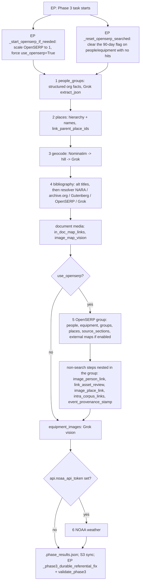

# Phase 3 map: every entity type, and how OpenSERP is engaged

Verified against the code on 2026-11-16 (commit `8602e789`). File references use `P3` for
`phase3_enrich_data.py` and `EP` for `ecs_entrypoint.py`. See `PHASE3_ENRICHMENT.md` for the
narrative description; this page records what the code actually does, and its gaps.

## Step order (`P3 main()`)

People, equipment and groups Grokipedia/Wikipedia enrichment runs in Phase 2, not here.

## Per entity type

| Entity | Phase 3 steps | External source | Skip rule (idempotency) |
|---|---|---|---|
| people | `openserp_people`; `image_person_link` | OpenSERP web + image search, Grok verify | 90-day `openserp_searched`, but reset every run for people with no hits |
| people_groups | `enrich_all_groups` (structured facts); `openserp_groups` (images, web, veterans associations, unit patch) | Grok; OpenSERP | `enrichment_data` present; `not_found` retried after 180 days; `ambiguous` retried every run |
| places | `enrich_all_places`; `link_parent_place_ids`; geocode cascade; `openserp_places`; `image_place_link` | Grok; Nominatim; DEM; OpenSERP | hierarchy has continent + country; verified coordinates or already attempted; 90-day OpenSERP |
| bibliography | `enrich_bibliography`; `resolve_bibliography_dir` | NARA, archive.org, Gutenberg, OpenSERP, Grok | `search_status=resolved` with `resource_urls` |
| maps | `in_doc_map_links`; `image_map_vision`; `openserp_external_maps` (off: `external_maps.enabled=false`) | Grok vision; OpenSERP | dedup by URL; decided images skipped |
| images | `image_map_vision`; `image_place_link` | Grok vision | decided images skipped |
| equipment | `openserp_equipment` (SPECIFIC records only); `equipment_images` | OpenSERP; Grok vision | 90-day flag, reset every run for equipment with no hits |
| source_section | `openserp_source_sections` (primary sources, plus French/German witness queries) | OpenSERP | 90-day flag; needs an `operation` |
| events, sub-events | `event_provenance_stamp` (deterministic `SourceSectionID`) | none | already stamped |
| weather | `noaa_weather` | NOAA CDO | `noaa_observed` present; no not-found marker |
| dates, logistics, casualties, supplemental | **none** (counted and integrity-checked only) | none | n/a |
| map_features | **not written by Phase 3** | n/a | n/a |

## How OpenSERP is engaged

- **Service.** OpenSERP is the vendored Go service `openserp/`, run as the ECS service
  `{env}-wwii-openserp` (desired count 0, Spot). The Phase 3 task scales it to 1 and finds its IP
  (`EP _start_openserp_if_needed`, line 719). Then it writes the URL into the config and sets
  `use_openserp=True` (`EP _patch_openserp_url`, line 773). At the end of the phase it scales the
  service back to 0 when no other phase still needs it. Backstops: the `openserp_manager` idle
  monitor, the `idle_backstop_reaper`, and on-demand NAT (`nat_manager`).
- **Query.** Templates come from `search_queries/*.yaml`, filled from record fields (name, unit,
  rank, nationality, identifier, year). Each query is
  `GET /mega/search?text=…&limit=5&mode=any`, which uses all configured engines, after a 5 s sleep.
  The client timeout is 60 s, and a circuit breaker opens after 5 consecutive failures.
- **Verification.** Domain denylists and name gates run first. Each result then gets a synchronous
  Grok YES/NO check (`_verify_result`, which fails closed). An accepted web result is fetched and
  summarised. Verdicts are cached in DynamoDB `dev-wwii-api-cache` (30 days positive, 7 days
  negative); URL verdicts and summaries are cached for 90 days.
- **Written.** `images[]` gets `{url, title, source}`. `military_awards[]`, `web_results[]`
  and `primary_sources[]` get `url`, `title`, `summary`, `fetched_at` and Wayback fields. Each
  search is also recorded as a fetch event (`recorded_fetch`).
- **Paths.** The inline path (`_run_openserp_enrichment`) is the live one. The SQS path
  (`phase3_enqueue_openserp.py` → queue → `openserp_worker.py`) has its infrastructure deployed,
  but nothing runs the enqueue script.

## Gaps found

| # | Severity | Gap |
|---|---|---|
| 1 | High | On ECS, `use_openserp: false` has no effect: the entrypoint starts the service (Fargate + NAT cost) and forces the flag on. |
| 2 | High | `event_provenance_stamp` (commented "Always runs"), `image_person_link`, `link_asset_review`, `image_place_link` and `intra_corpus_links` are not web searches but sit inside the OpenSERP group, so they are skipped when the flag is off or the import fails. |
| 3 | High (latent) | In Phase 3 batch mode (`BATCH_PHASE3`), OpenSERP verify calls are queued, read as "no", cached as REJECT for 90 days and the entity is stamped searched. `_run_batch_rerun` re-runs neither OpenSERP nor geocoding. |
| 4 | Med | People and equipment with no hits are re-searched on every run (`EP _reset_openserp_searched`), defeating the 90-day gate. |
| 5 | Med | Weather records created before their place was geocoded never get coordinates, so they get neither Open-Meteo nor NOAA data. |
| 6 | Med | The NOAA step never runs: `api.noaa_api_token` is empty and no env or secret supplies it. `validate_phase3` warns about 0 `noaa_observed` on every run, which is a benign alert. |
| 7 | Med | OpenSERP image items store no query, engine or verifier verdict; the fetch event is not linked to the item. Verdict cache key is truncated (`context[:50]|title[:50]|url[:60]`). |
| 8 | Med | Places searches have no result cap or name gate and run once per name variant. `openserp.results_per_query` is not read (the limit is hardcoded to 5). |
| 9 | Med | `supplemental_search.search_openserp` / `search_gutenberg_openserp` POST to `/search`, which the server does not serve; the errors are swallowed at debug level. |
| 10 | Med | `openserp_manager` matches "openserp" in task ARNs, which never contain it (`nat_manager` already fixed this). |
| 11 | Low | SQS path: unwired; would search generic equipment; looks for `source_section/` at the wrong path. |
| 12 | Low | `ambiguous` groups retried every run; places OpenSERP does not record eligibility, so its starvation check is blind; no alarm when OpenSERP is unreachable. |
| 13 | Low | Dead code: `enrich_with_advanced_features`, `_verify_results_batch`, `search_academic_sources`, `phase3_retry.py` (checks people only, never called). |
