# Pipeline Workflow Diagrams

Visual representations of the WWII data extraction pipeline phases.

**Last Updated:** 2026-11-17. The Mermaid source below is current for Phases 0-3 (checked against `lambda_handlers/trigger_handler.py`, `phase1_parse.py`, `phase2_extract.py`, `phase3_enrich_data.py`, `src/utils/batch_rounds.py`). The PNGs in `images/` are rendered from these blocks by `scripts/render_mermaid_diagrams.py` (it re-renders only a diagram whose source hash in `images/mermaid_manifest.json` changed; set `MERMAID_NO_SANDBOX=1` where the OS blocks Chrome's sandbox). Re-run it after editing a diagram.

---

## Phase 0: Ingestion (before Phase 1)

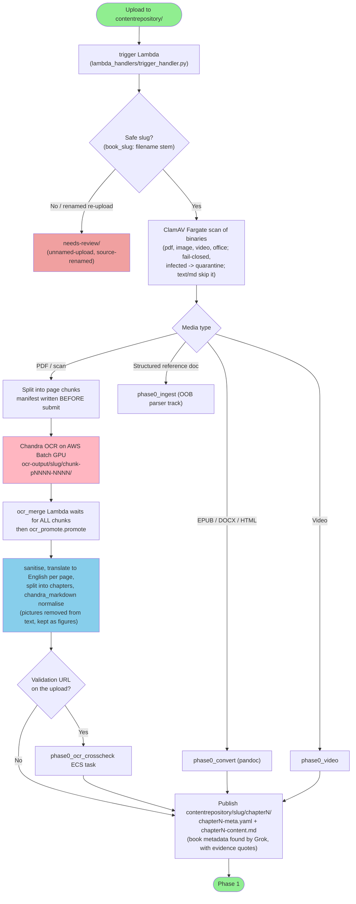

**Key operations:**
- A book's slug is its filename stem and never changes (`src/ingestion/book_slug.py`).
- Bad uploads go to `needs-review/`; nothing is processed under a shared `unknown` name.
- OCR is chunked by pages; the merge Lambda acts only when every chunk of the submission is present.

---

## Phase 1: Parse Workflow

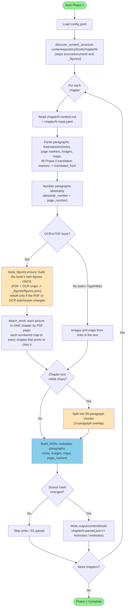

**Key Operations:**
- Markdown → JSON conversion with absolute paragraph numbering and page numbers
- Book figures built once per OCR'd PDF book, then attached per chapter
- Auto-splitting of chapters over 400K characters
- Unchanged chapters are not rewritten or re-uploaded

---

## Phase 2: Extract Workflow

```mermaid
flowchart TD
    Start([Start Phase 2]) --> LoadConfig[Load config.yaml]
    LoadConfig --> CompleteMeta["Step 0: Complete missing metadata"]
    CompleteMeta --> InitGrok["Initialize Grok client + API cache<br/>(batch mode in AWS)"]
    InitGrok --> Round["<b>Batch round N</b> (cap batch.max_rounds = 8)"]

    Round --> Step1["<b>Step 1: Core extraction</b><br/>process_chapters_parallel"]
    Step1 --> Events["Events: ONE request per chapter<br/>(Event + Sub-events; orphan paragraphs claimed<br/>by nearest earlier sub-event)"]
    Events --> Emit["Emit source_section anchor<br/>(title + EventID)"]
    Emit --> Windows["Discovery over fixed 3-paragraph WINDOWS<br/>of the RAW parsed text (windows.py):<br/>Dates | Places | Groups | People"]
    Windows --> Settle["windows.settle: attribute each item to the<br/>real sub-event by where its quote is;<br/>unsupported quote -> dropped (quote_unsupported)"]
    Settle --> NativeEnrich["<b>Native Grokipedia/Wikipedia enrichment</b><br/>People: bio + portrait + awards | Groups | Places"]

    NativeEnrich --> Step2["Step 2: Retry missing events"]
    Step2 --> Bib["Step 3: Deterministic bibliography<br/>(one record per footnote/endnote, no LLM)"]
    Bib --> OptGate{"Optional features enabled?"}
    OptGate -->|Yes| Opt["Per event file, windowed:<br/>Weather | Equipment (broad + refine) |<br/>Logistics | Casualties | Supplemental (notes)"]
    OptGate -->|No| Maps
    Opt --> Maps["External maps (OpenSERP if enabled) + Images"]

    Maps --> Queued{"This pass queued<br/>new requests?"}
    Queued -->|Yes| Submit["Submit xAI batch, wait in-task<br/>up to batch.in_task_wait_minutes"]
    Submit --> Answered{Answered?}
    Answered -->|Yes| Round
    Answered -->|No| Poller["Hand off to batch-poller Lambda (5 min)<br/>-> launches --retrieve-only task"]
    Poller --> Round
    Queued -->|"No (quiescent)"| Step4b
    Queued -->|"Round cap reached"| CapAlert["alert batch.rounds_over_cap + stop"]

    Step4b["<b>Step 4b: Source-section enrichment</b><br/>summary + operation label (null-over-fake)<br/>+ Grok/Wikipedia articles and media"] --> Step5

    Step5["Step 5: Analysis: duplicate people + related groups reports"] --> Post["Exact-duplicate auto-merge,<br/>dedup report, provenance validation<br/>(scripts/validate_provenance.py)"]
    Post --> Gate["Dedup gate: auto-proceeds when no duplicate groups (corpus under 500 entities);<br/>else Phase 3 blocked until human review (Dedup Review UI)"]
    Gate --> End([Phase 2 Complete])
    CapAlert --> End

    style Start fill:#90EE90
    style End fill:#90EE90
    style Step1 fill:#87CEEB
    style NativeEnrich fill:#FFB6C1
    style Step4b fill:#FFB6C1
    style Step5 fill:#DDA0DD
    style CapAlert fill:#F0A0A0
```

**Key operations:**
- One Event per source section, one events request per chapter; every other entity is discovered over fixed 3-paragraph windows of the raw text and attributed to its real sub-event by its quote.
- **Phase 2 owns ALL Grokipedia/Wikipedia enrichment** (people, groups, places, equipment), committed through each entity's native path.
- Batch rounds repeat until a pass queues nothing; a batch not answered in-task is retrieved by the poller Lambda.
- Step 4b derives the section summary + canonical operation label, then fetches the operation's Grok/Wiki articles + Wikipedia media.
- Alerts go to the `{env}-wwii-phase2-complete` SNS topic (email + Slack).

---

## Phase 3: Enrich Workflow

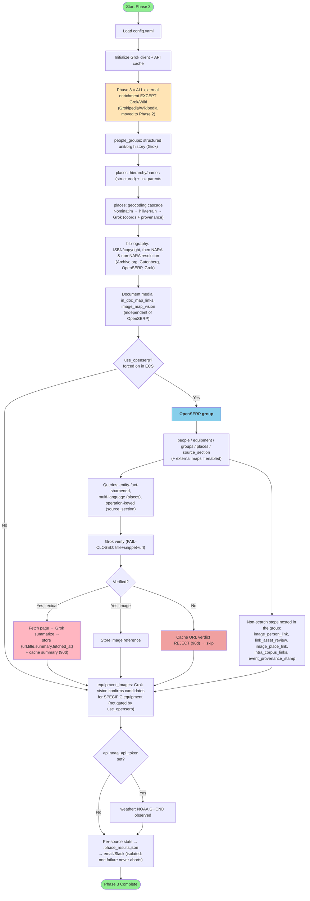

**Key operations:**
- No Grokipedia/Wikipedia here — that is Phase 2. Phase 3 keeps geocoding, NOAA, OpenSERP, and
  NARA + non-NARA bibliography resolution, plus the *structured* hierarchy/org-history Grok
  passes (which promote facts into spec fields, not descriptive text).
- The OpenSERP group covers people, equipment, groups, places and source_section with fact-sharpened / multi-language / operation-keyed queries. Dates, casualties, logistics and events have no search step.
- Positive URLs are Grok-verified **fail-closed**, then textual pages are fetched + summarized;
  every URL verdict (summary or REJECT) is cached 90 days to prevent reprocessing.
- Each source isolated via `_run_step`; outcomes surface through `.phase_results.json`.
- Per-entity detail and known gaps: [PHASE3_MAP.md](PHASE3_MAP.md).

---

## Complete Pipeline Flow

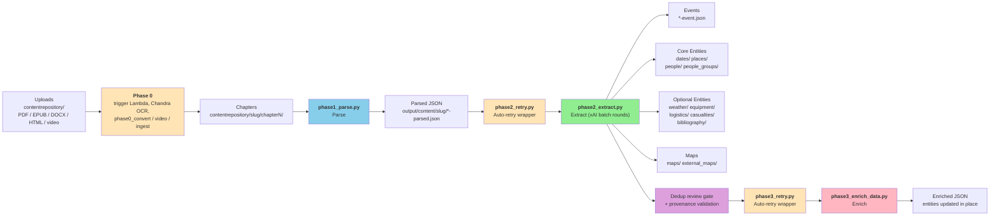

In AWS, entity records live in S3 (`output/<entity>/*.json`) and run state in the DynamoDB `{env}-wwii-api-cache` table. The former MongoDB and DynamoDB import steps were removed (`import_to_mongodb.py`, `import_to_dynamodb.py`); merge pointers live in `{env}-wwii-id-aliases`.

---

## Event Extraction Detail

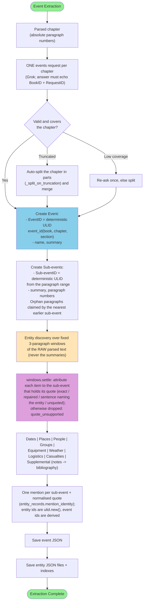

---

## Entity Deduplication Flow

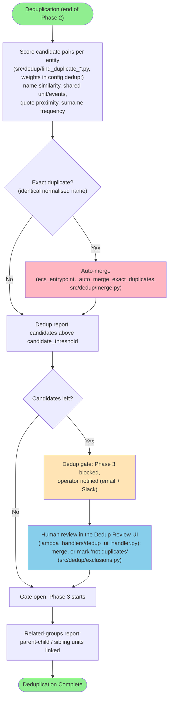

---

## Validation Workflow

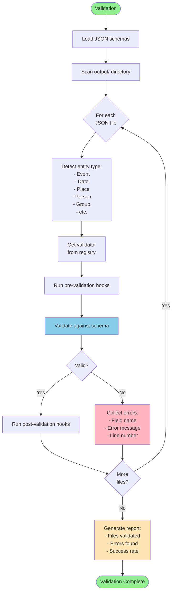

---

## Batch Processing Flow

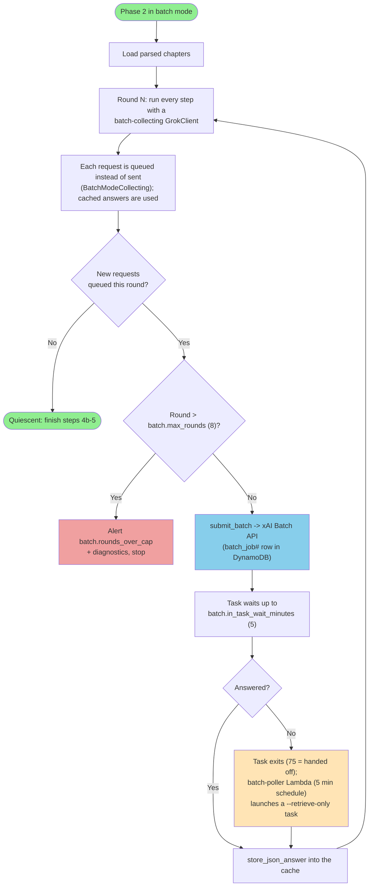

**Key Design:**
- Work that needs an earlier answer (for example equipment refine needs the broad answer) is asked in the next round; rounds repeat until a pass queues nothing.
- Answers come back through the same cache keys, so a re-run never re-asks (`src/utils/batch_rounds.py`, `src/utils/batch_api.py`).
- A chapter is processed concurrently with up to `max_parallel` others (`process_chapters_parallel`), and a failure in one chapter or entity does not stop the others (`return_exceptions=True`).
- Targeted cache clearing on failure (per entry, not a full wipe).

---

## Cache Management Flow

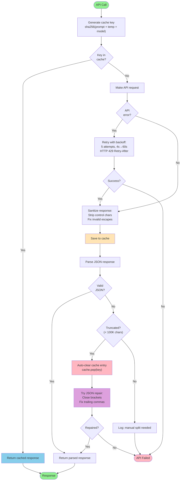

**Key Design:**
- Cache key = sha256 of system prompt + prompt + temperature + model (plus the book scope for book-bound kinds)
- Per-type cache directories: `cache/api/{events,dates,places,people,...}`
- Auto-clear corrupted entries (truncated/short responses) — no manual intervention
- JSON repair attempted before failing
- Retry with exponential backoff + HTTP 429 Retry-After support

---

## MongoDB Import Flow (removed)

The MongoDB import script (`import_to_mongodb.py`) no longer exists, so its diagram was removed. Entity records are stored as JSON in S3 (`output/<entity>/*.json`); There is no importer: S3 is the record store. Its PNG is archived at `docs/archive/2026-11-16/core/images/mongodb_import_flow.png`.

---

## Error Handling & Recovery Flow

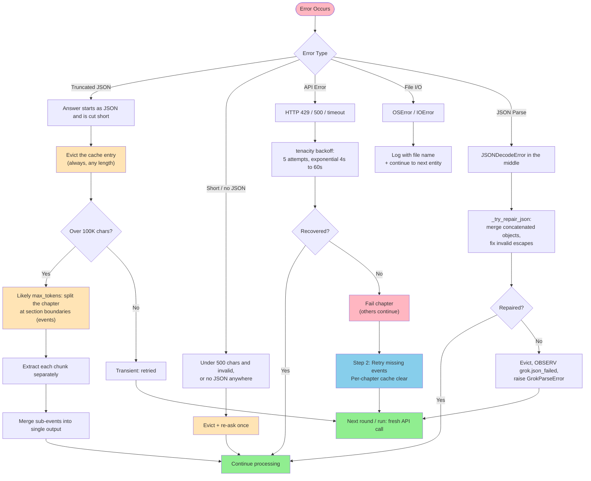

**Key Principles:**
- Errors are isolated: one chapter/entity failure doesn't stop the pipeline
- Cache corruption evicts the specific entry (not the whole cache)
- Truncated events answers over 100K chars split the chapter at section boundaries and re-extract
- The retry step catches anything missed in the parallel phase
- A total JSON loss is never silent: it logs `OBSERV grok.json_failed`

See [JSON_REPAIR.md](JSON_REPAIR.md) and [CACHE_AUTO_RECOVERY.md](CACHE_AUTO_RECOVERY.md).

---

## Legend

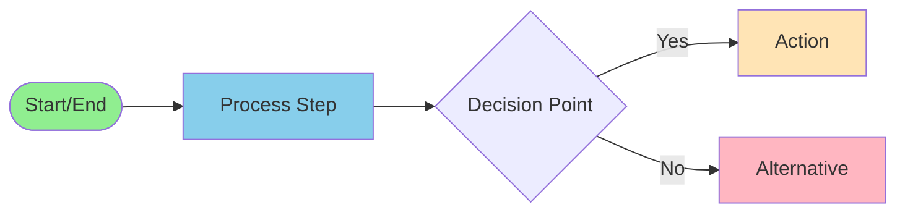

**Colors:**
- 🟢 Green: Start/End points
- 🔵 Blue: Core processing steps
- 🟡 Yellow: Optional/alternative steps
- 🔴 Pink: API calls/external operations
- 🟣 Purple: Data operations (merge, deduplicate, index)

---

**Generated:** 2026-03-15  
**Updated:** 2026-11-17 (Phase 3 and Phase 1 diagrams revised; Phases 0-2, dedup, batch, error flows checked 2026-11-16)  
**Pipeline Version:** 2.0
